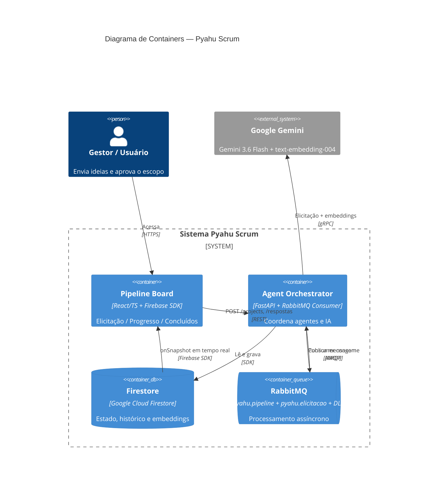

# Pyahu Scrum 🚀

Bem-vindo ao **Pyahu Scrum**, um framework autônomo de orquestração desenvolvido para a categoria *Taskmaster* do Google Agent Hackathon.

Este projeto democratiza a engenharia de decisão: captura ideias brutas de negócio e, através de agentes assíncronos rodando em segundo plano, as traduz em especificações técnicas rigorosas (ADRs, spec, PRD) e tickets de desenvolvimento executáveis — tudo via elicitação interativa com o Gemini.

---

## 🌐 Ambientes

| Ambiente | URL |
|---|---|
| **Homologação** (develop) | https://homolog.pyahuscrum.adbfn6.easypanel.host |
| **API** | https://api-homolog.pyahuscrum.adbfn6.easypanel.host |
| **Firestore** | [console.firebase.google.com/project/pyahu-scrum/firestore](https://console.firebase.google.com/project/pyahu-scrum/firestore) |

---

## 🏗️ Estrutura do Repositório (Monorepo)

```
PyahuScrum/
├── frontend/          # React/TypeScript — interface do pipeline
├── backend/           # FastAPI — Agent Orchestrator (Python)
├── infra/             # Dockerfiles + docker-compose (homolog/prod)
├── specs/             # Specs e PRDs por fatia
├── docs/adr/          # Architecture Decision Records
├── firestore.rules    # Security Rules do Firestore
└── firebase.json      # Config para deploy das rules via CLI
```

---

## ⚙️ Arquitetura

A arquitetura orientada a eventos garante que a interface nunca fique bloqueada enquanto os agentes realizam o trabalho pesado.

```
Usuário cria projeto
   ↓
POST /projects  →  Firestore (TRIAGEM_INICIAL)  →  pyahu.pipeline (RabbitMQ)
                                                          ↓
                                                    Consumer (thread)
                                                          ↓
                                                    Gemini (Rodada 1)
                                                          ↓
                                              Firestore (ELICITANDO + perguntas)
                                                          ↓
                                              onSnapshot → Frontend (cards)
                                                          ↓
                                              Usuário responde → pyahu.elicitacao
                                                          ↓
                                              Consumer → Gemini (próxima rodada)
                                                          ↓
                                              CONCLUIDO → spec + prd + ADRs + tickets (ZIP)
```

### Diagrama C4



### RAG — Recuperação de Histórico

O backend gera embeddings (`text-embedding-004`) dos projetos concluídos e realiza busca por similaridade de cosseno em Python (sem índice vetorial em homolog, preparado para Firestore Vector Search em produção):

$$\text{sim}(q,d)=\frac{q\cdot d}{\|q\|\|d\|}$$

O contexto histórico é injetado no prompt de geração de artefatos — cada spec gerada leva em conta projetos anteriores similares.

---

## 🛠️ Stack

| Camada | Tecnologia |
|---|---|
| Frontend | React 18 + TypeScript + Firebase SDK |
| Backend | FastAPI + Python 3.11 |
| IA | Google Gemini 3.6 Flash + text-embedding-004 |
| Fila | RabbitMQ (homolog) → Google Cloud Pub/Sub (prod) |
| Banco | Google Cloud Firestore (real, projeto `pyahu-scrum`) |
| Infra | Docker + Traefik + Easypanel |

---

## 🚀 Como executar localmente

### Pré-requisitos

- Docker + Docker Compose
- Node.js 22+
- Python 3.11+
- Conta GCP com projeto Firestore habilitado

### 1. Clone o repositório

```bash
git clone https://github.com/edcastanha/PyahuScrum.git
cd PyahuScrum
```

### 2. Backend

```bash
cd backend
cp .env.example .env
# Edite o .env:
#   GEMINI_API_KEY=<sua chave>
#   GOOGLE_CLOUD_PROJECT=pyahu-scrum
#   GOOGLE_APPLICATION_CREDENTIALS=./pyahu-scrum-sa.json
# Coloque o service account JSON em backend/pyahu-scrum-sa.json

pip install -r requirements.txt
uvicorn app.main:app --reload --port 8001
```

> Para desenvolvimento local com emulador Firestore: `export REACT_APP_USE_EMULATOR=true` e `export FIRESTORE_EMULATOR_HOST=localhost:8080`

### 3. Frontend

```bash
cd frontend
npm install
# Copie as variáveis de ambiente:
cp .env.example .env.local
# Edite REACT_APP_AGENT_ORCHESTRATOR_URL=http://localhost:8001
npm start
```

### 4. Stack completa (homolog via Docker)

```bash
# Pré-requisito: backend/pyahu-scrum-sa.json presente
git checkout develop && git pull origin develop
docker compose -f infra/docker-compose.homolog.yml up -d --build
```

---

## 🔥 Firestore Security Rules

O frontend acessa o Firestore diretamente via Firebase SDK (onSnapshot em tempo real). As rules permitem leitura pública e bloqueiam escrita pelo browser — o backend escreve via Service Account (ignora rules):

```javascript
rules_version = '2';
service cloud.firestore {
  match /databases/{database}/documents {
    match /projects/{projectId} {
      allow read: if true;
      allow write: if false;
      match /elicitacao/{rodada} {
        allow read: if true;
        allow write: if false;
      }
    }
  }
}
```

Para publicar as rules via CLI:
```bash
GOOGLE_APPLICATION_CREDENTIALS=backend/pyahu-scrum-sa.json \
  firebase deploy --only firestore:rules --project pyahu-scrum
```

---

## 🗂️ Pipeline de Elicitação

O pipeline passa por 4 fases visíveis na sidebar:

| Página | Rota | Status do projeto |
|---|---|---|
| **Em Elicitação** | `/pipeline/elicitacao` | `TRIAGEM_INICIAL`, `ELICITANDO` |
| **Em Progresso** | `/pipeline/progresso` | `AGUARDANDO_APROVACAO_ESCOPO`, `GERANDO_ADR` |
| **Concluídos** | `/pipeline/concluido` | `CONCLUIDO` |

Cada card exibe o histórico de rodadas (1–4). Rodadas respondidas ficam desabilitadas. Na página Concluídos, o botão **⬇ Baixar ZIP** entrega `spec.md + prd.md + ADRs + tickets`.

---

## 🛡️ Governança e Human-in-the-Loop

O Pyahu Scrum implementa política estrita de resiliência:

- **Retry automático** — até 3 tentativas por mensagem antes de ir para a DLQ (`pyahu.pipeline.dlq`)
- **Guard de delete** — consumer verifica se o projeto ainda existe antes de processar mensagens órfãs
- **HITL** — mudanças de escopo detectadas pelo Gemini pausam o pipeline (`AGUARDANDO_APROVACAO_ESCOPO`) até aprovação explícita do usuário

---

## 📁 Credenciais e Segredos

| Arquivo | Descrição | Gitignored |
|---|---|---|
| `backend/.env` | `GEMINI_API_KEY`, `GOOGLE_CLOUD_PROJECT`, `GOOGLE_APPLICATION_CREDENTIALS` | ✅ |
| `backend/pyahu-scrum-sa.json` | Service Account GCP (Firestore + Vertex AI) | ✅ |

**Nunca commitar credenciais.** O `.gitignore` já bloqueia `*.json` sensíveis na pasta `backend/`.
