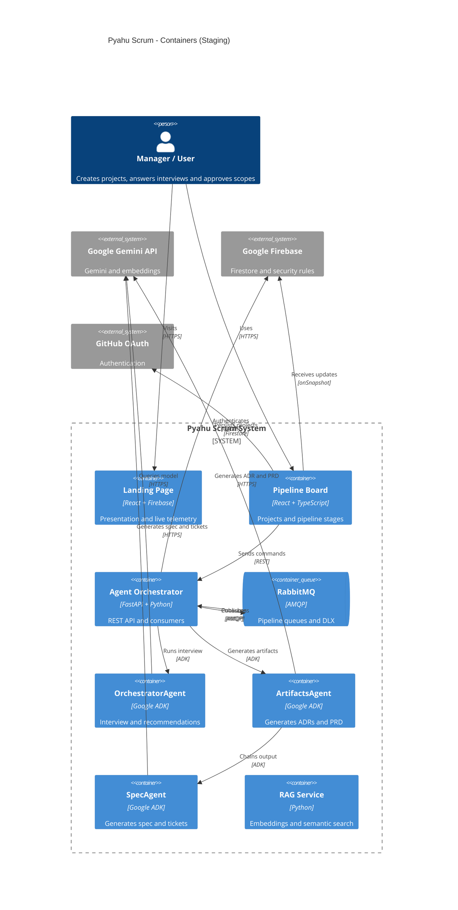
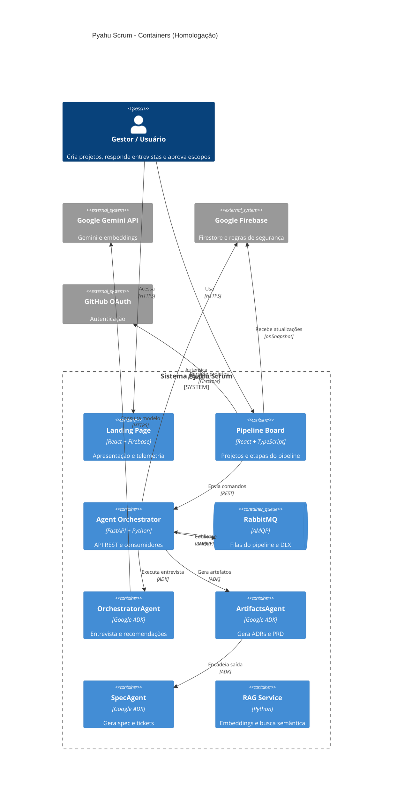

# Pyahu Scrum 🚀

<div align="center">

**🌐 Select your language / Selecione seu idioma / Seleccione su idioma:**

[](#english)
[](#português)
[](#español)

</div>

---

<a name="english"></a>
## 🇺🇸 English

**Pyahu Scrum** is an autonomous orchestration framework built for the **Taskmaster** category of the [Agent Development Kit Hackathon with Google Cloud](https://googlecloudmultiagents.devpost.com/).

It democratizes decision engineering: captures raw business ideas and, through **multiple ADK agents collaborating in the background**, translates them into rigorous technical specifications (ADRs, Spec, PRD) and executable development tickets — all via interactive Grill-Me-style elicitation.

### 🌐 Environments

| Environment | URL |
|---|---|
| **Staging** (develop) | https://homolog.pyahuscrum.adbfn6.easypanel.host |
| **API** | https://api-homolog.pyahuscrum.adbfn6.easypanel.host |
| **GCP Project** | `pyahu-scrum` |
| **Firestore** | [console.firebase.google.com/project/pyahu-scrum/firestore](https://console.firebase.google.com/project/pyahu-scrum/firestore) |

### 🤖 ADK Agents

The pipeline is orchestrated by **3 Google ADK 2.8 agents** working in collaboration:

| Agent | Role | ADK Type |
|---|---|---|
| **OrchestratorAgent** | Grill-style elicitation (rounds Q1..Qn with ➡️ recommendations) | `LlmAgent` |
| **ArtifactsAgent** | Generates ADRs (Architecture Decision Records) + PRD | `LlmAgent` |
| **SpecAgent** | Generates technical Spec + atomic development tickets | `LlmAgent` |

#### Collaboration flow

```
OrchestratorAgent  (up to 4 elicitation rounds, HITL)
      ↓ user approves scope
SequentialAgent: ArtifactsAgent → SpecAgent
      ↓
ZIP: spec.md + prd.md + ADRs + tickets
```

> **Resilient fallback:** when ADK is unavailable (quota / pending billing), the system automatically falls back to direct Gemini calls — **the pipeline never stops**.

### ⚙️ Architecture

#### Complete flow

```
User visits /              →  Landing Page (React + live telemetry)
User visits /login         →  GitHub OAuth authentication
User creates project       →  ProjectsPage → idea form

POST /projects
  → Firestore: { status: TRIAGEM_INICIAL }
  → RabbitMQ: pyahu.pipeline
  → Immediate 201 response

Consumer thread (pyahu.pipeline)
  ├─ Tries: ADK OrchestratorAgent  (gemini-3.6-flash via Gemini API)
  └─ Automatic fallback: google-genai direct  (if quota/billing unavailable)
  → Firestore: { status: ELICITANDO, perguntas_abertas: [Q1..Q5 + recommendations] }
  → onSnapshot → Pipeline Board → "In Elicitation" (card with rounds)

User answers questions  →  POST /projects/{id}/respostas
  → RabbitMQ: pyahu.elicitacao  (type: resposta)
  → Consumer → OrchestratorAgent (next round)
  → Repeats until: pronto: true | round 4 | user forces (≥ R2)

OrchestratorAgent signals completion
  → Gemini generates Scope Summary (markdown)
  → Firestore: { status: AGUARDANDO_APROVACAO_ESCOPO, resumo_escopo: "..." }

HITL — User reviews the summary
  ├─ ✅ Approve  →  POST /projects/{id}/aprovar
  │               →  ADK SequentialAgent: ArtifactsAgent → SpecAgent
  │               →  Firestore: { status: CONCLUIDO, artefatos: {...} }
  │               →  onSnapshot → "Completed" card + ⬇ ZIP button
  │
  └─ 📝 Revise   →  POST /projects/{id}/revisao  { feedback: "..." }
                  →  Gemini decides: more rounds or updated summary

User deletes project  →  DELETE /projects/{id}
  → Firestore: removes doc + elicitacao/ subcollection (cascade)
  → onSnapshot → card removed in real time across all open pages
```

#### Pipeline state table

| Status | Set by | Next action |
|---|---|---|
| `TRIAGEM_INICIAL` | `POST /projects` | Consumer → OrchestratorAgent (Round 1) |
| `ELICITANDO` | OrchestratorAgent | onSnapshot → "In Elicitation" card |
| `AGUARDANDO_APROVACAO_ESCOPO` | Elicitation complete | onSnapshot → "In Progress" card with markdown summary |
| `GERANDO_ADR` | Approval received | SequentialAgent: ArtifactsAgent → SpecAgent |
| `CONCLUIDO` | SpecAgent | onSnapshot → "Completed" card + ⬇ ZIP |
| `FALHA_PROCESSAMENTO` | 3 retries exhausted | Message → DLQ · card shows error |

#### C4 Diagram



### 🛠️ Stack

| Layer | Technology |
|---|---|
| Frontend | React 18 + TypeScript + Firebase SDK |
| Backend | FastAPI + Python 3.12 |
| **Agents** | **Google ADK 2.8** (OrchestratorAgent + ArtifactsAgent + SpecAgent) |
| AI | Google Gemini Flash + text-embedding-004 |
| Queue | RabbitMQ (staging) → Google Cloud Pub/Sub (production) |
| Database | Google Cloud Firestore (real, project `pyahu-scrum`) |
| Infra | Docker + Traefik + Easypanel |

### 🚀 Running locally

```bash
# 1. Clone
git clone https://github.com/edcastanha/PyahuScrum.git
cd PyahuScrum

# 2. Backend credentials — create backend/pyahu-scrum-sa.json (Service Account GCP)
cd backend
cat > .env << EOF
GEMINI_API_KEY=<your_gemini_api_key>
GOOGLE_CLOUD_PROJECT=pyahu-scrum
GOOGLE_APPLICATION_CREDENTIALS=/app/pyahu-scrum-sa.json
EOF

# 3. Full stack via Docker (staging)
git checkout develop && git pull origin develop
docker compose -f infra/docker-compose.homolog.yml up -d --build
```

### 🛡️ Governance & Human-in-the-Loop

- **Automatic retry** — up to 3 attempts per message before going to DLQ
- **Delete guard** — consumer checks if project still exists before processing orphan messages
- **HITL approval** — user reviews Gemini-generated scope summary and approves or requests revision
- **ADK → Gemini fallback** — if ADK fails (quota/billing), pipeline continues with direct Gemini calls

[⬆ Back to top](#pyahu-scrum-)

---

<a name="português"></a>
## 🇧🇷 Português

**Pyahu Scrum** é um framework autônomo de orquestração desenvolvido para a categoria **Taskmaster** do [Agent Development Kit Hackathon with Google Cloud](https://googlecloudmultiagents.devpost.com/).

Este projeto democratiza a engenharia de decisão: captura ideias brutas de negócio e, através de **múltiplos agentes ADK colaborando em segundo plano**, as traduz em especificações técnicas rigorosas (ADRs, Spec, PRD) e tickets de desenvolvimento executáveis — tudo via elicitação interativa no estilo Grill-Me.

### 🌐 Ambientes

| Ambiente | URL |
|---|---|
| **Homologação** (develop) | https://homolog.pyahuscrum.adbfn6.easypanel.host |
| **API** | https://api-homolog.pyahuscrum.adbfn6.easypanel.host |
| **Projeto GCP** | `pyahu-scrum` |
| **Firestore** | [console.firebase.google.com/project/pyahu-scrum/firestore](https://console.firebase.google.com/project/pyahu-scrum/firestore) |

### 🤖 Agentes ADK

O pipeline é orquestrado por **3 agentes Google ADK 2.8** em colaboração:

| Agente | Função | Tipo ADK |
|---|---|---|
| **OrchestratorAgent** | Elicitação grill-style (rounds Q1..Qn com ➡️ recomendações) | `LlmAgent` |
| **ArtifactsAgent** | Gera ADRs (Architecture Decision Records) + PRD | `LlmAgent` |
| **SpecAgent** | Gera Spec técnica + Tickets de desenvolvimento atômicos | `LlmAgent` |

#### Fluxo de colaboração

```
OrchestratorAgent  (até 4 rodadas de elicitação, HITL)
      ↓ usuário aprova escopo
SequentialAgent: ArtifactsAgent → SpecAgent
      ↓
ZIP: spec.md + prd.md + ADRs + tickets
```

> **Fallback resiliente:** quando o ADK está indisponível (quota / billing pendente), o sistema cai automaticamente para chamadas diretas ao Gemini — **o pipeline nunca para**.

### ⚙️ Arquitetura

#### Fluxo completo

```
Usuário acessa /            →  Landing Page (React + telemetria live)
Usuário acessa /login       →  Autenticação GitHub OAuth
Usuário cria projeto        →  ProjectsPage → formulário de ideia

POST /projects
  → Firestore: { status: TRIAGEM_INICIAL }
  → RabbitMQ: pyahu.pipeline
  → Retorno imediato 201

Consumer thread (pyahu.pipeline)
  ├─ Tenta: ADK OrchestratorAgent  (gemini-3.6-flash via Gemini API)
  └─ Fallback automático: google-genai direto
  → Firestore: { status: ELICITANDO, perguntas_abertas: [Q1..Q5 + recomendações] }
  → onSnapshot → Pipeline Board → "Em Elicitação" (card com rodadas)

Usuário responde perguntas  →  POST /projects/{id}/respostas
  → Consumer → OrchestratorAgent (próxima rodada)
  → Repete até: pronto: true | rodada 4 | usuário força (≥ R2)

OrchestratorAgent sinaliza conclusão
  → Gemini gera Resumo de Escopo (markdown)
  → Firestore: { status: AGUARDANDO_APROVACAO_ESCOPO }

HITL — Usuário analisa o resumo
  ├─ ✅ Aprova   →  POST /projects/{id}/aprovar
  │               →  ADK SequentialAgent: ArtifactsAgent → SpecAgent
  │               →  Firestore: { status: CONCLUIDO, artefatos: {...} }
  │               →  onSnapshot → card "Concluídos" + botão ⬇ ZIP
  │
  └─ 📝 Revisão  →  POST /projects/{id}/revisao  { feedback: "..." }
                  →  Gemini decide: mais rodadas ou resumo atualizado

Usuário exclui projeto  →  DELETE /projects/{id}
  → Firestore: remove doc principal + subcoleção elicitacao/ (cascade)
  → onSnapshot → card removido em tempo real em todas as páginas abertas
```

#### Tabela de estados do pipeline

| Status | Quem define | O que acontece a seguir |
|---|---|---|
| `TRIAGEM_INICIAL` | `POST /projects` | Consumer → OrchestratorAgent (Rodada 1) |
| `ELICITANDO` | OrchestratorAgent | onSnapshot → card "Em Elicitação" com perguntas |
| `AGUARDANDO_APROVACAO_ESCOPO` | Entrevista concluída | onSnapshot → card "Em Progresso" com resumo markdown |
| `GERANDO_ADR` | Aprovação recebida | SequentialAgent: ArtifactsAgent → SpecAgent |
| `CONCLUIDO` | SpecAgent | onSnapshot → card "Concluídos" + botão ⬇ ZIP |
| `FALHA_PROCESSAMENTO` | 3 tentativas esgotadas | Mensagem → DLQ · card mostra erro |

#### Diagrama C4



### 🛠️ Stack

| Camada | Tecnologia |
|---|---|
| Frontend | React 18 + TypeScript + Firebase SDK |
| Backend | FastAPI + Python 3.12 |
| **Agentes** | **Google ADK 2.8** (OrchestratorAgent + ArtifactsAgent + SpecAgent) |
| IA | Google Gemini Flash + text-embedding-004 |
| Fila | RabbitMQ (homolog) → Google Cloud Pub/Sub (prod) |
| Banco | Google Cloud Firestore (real, projeto `pyahu-scrum`) |
| Infra | Docker + Traefik + Easypanel |

### 🚀 Como executar localmente

```bash
# 1. Clone
git clone https://github.com/edcastanha/PyahuScrum.git
cd PyahuScrum

# 2. Credenciais GCP — crie backend/pyahu-scrum-sa.json (Service Account)
cd backend
cat > .env << EOF
GEMINI_API_KEY=<sua_chave_gemini_api>
GOOGLE_CLOUD_PROJECT=pyahu-scrum
GOOGLE_APPLICATION_CREDENTIALS=/app/pyahu-scrum-sa.json
EOF

# 3. Stack completa via Docker (homolog)
git checkout develop && git pull origin develop
docker compose -f infra/docker-compose.homolog.yml up -d --build
```

### 🛡️ Governança e Human-in-the-Loop

- **Retry automático** — até 3 tentativas por mensagem antes de ir para a DLQ
- **Guard de delete** — consumer verifica se o projeto ainda existe antes de processar mensagens órfãs
- **HITL de aprovação** — usuário revisa resumo de escopo gerado pelo Gemini e aprova ou solicita revisão
- **Fallback ADK → Gemini** — se o ADK falhar (quota/billing), o pipeline continua com chamadas diretas ao Gemini

[⬆ Voltar ao topo](#pyahu-scrum-)

---

<a name="español"></a>
## 🇪🇸 Español

**Pyahu Scrum** es un framework autónomo de orquestación desarrollado para la categoría **Taskmaster** del [Agent Development Kit Hackathon with Google Cloud](https://googlecloudmultiagents.devpost.com/).

Este proyecto democratiza la ingeniería de decisiones: captura ideas brutas de negocio y, a través de **múltiples agentes ADK colaborando en segundo plano**, las traduce en especificaciones técnicas rigurosas (ADRs, Spec, PRD) y tickets de desarrollo ejecutables — todo mediante elicitación interactiva al estilo Grill-Me.

### 🌐 Entornos

| Entorno | URL |
|---|---|
| **Homologación** (develop) | https://homolog.pyahuscrum.adbfn6.easypanel.host |
| **API** | https://api-homolog.pyahuscrum.adbfn6.easypanel.host |
| **Proyecto GCP** | `pyahu-scrum` |
| **Firestore** | [console.firebase.google.com/project/pyahu-scrum/firestore](https://console.firebase.google.com/project/pyahu-scrum/firestore) |

### 🤖 Agentes ADK

El pipeline es orquestado por **3 agentes Google ADK 2.8** en colaboración:

| Agente | Función | Tipo ADK |
|---|---|---|
| **OrchestratorAgent** | Elicitación grill-style (rondas Q1..Qn con ➡️ recomendaciones) | `LlmAgent` |
| **ArtifactsAgent** | Genera ADRs (Architecture Decision Records) + PRD | `LlmAgent` |
| **SpecAgent** | Genera Spec técnica + Tickets de desarrollo atómicos | `LlmAgent` |

#### Flujo de colaboración

```
OrchestratorAgent  (hasta 4 rondas de elicitación, HITL)
      ↓ usuario aprueba el alcance
SequentialAgent: ArtifactsAgent → SpecAgent
      ↓
ZIP: spec.md + prd.md + ADRs + tickets
```

> **Fallback resiliente:** cuando el ADK no está disponible (cuota / facturación pendiente), el sistema cae automáticamente a llamadas directas a Gemini — **el pipeline nunca se detiene**.

### ⚙️ Arquitectura

#### Flujo completo

```
Usuario visita /            →  Landing Page (React + telemetría en vivo)
Usuario visita /login       →  Autenticación GitHub OAuth
Usuario crea proyecto       →  ProjectsPage → formulario de idea

POST /projects
  → Firestore: { status: TRIAGEM_INICIAL }
  → RabbitMQ: pyahu.pipeline
  → Retorno inmediato 201

Consumer thread (pyahu.pipeline)
  ├─ Intenta: ADK OrchestratorAgent  (gemini-3.6-flash via Gemini API)
  └─ Fallback automático: google-genai directo
  → Firestore: { status: ELICITANDO, perguntas_abertas: [Q1..Q5 + recomendaciones] }
  → onSnapshot → Pipeline Board → "En Elicitación" (tarjeta con rondas)

Usuario responde preguntas  →  POST /projects/{id}/respostas
  → Consumer → OrchestratorAgent (siguiente ronda)
  → Repite hasta: pronto: true | ronda 4 | usuario fuerza (≥ R2)

OrchestratorAgent señala conclusión
  → Gemini genera Resumen de Alcance (markdown)
  → Firestore: { status: AGUARDANDO_APROVACAO_ESCOPO }

HITL — Usuario analiza el resumen
  ├─ ✅ Aprueba  →  POST /projects/{id}/aprovar
  │               →  ADK SequentialAgent: ArtifactsAgent → SpecAgent
  │               →  Firestore: { status: CONCLUIDO, artefatos: {...} }
  │               →  onSnapshot → tarjeta "Completados" + botón ⬇ ZIP
  │
  └─ 📝 Revisión →  POST /projects/{id}/revisao  { feedback: "..." }
                  →  Gemini decide: más rondas o resumen actualizado

Usuario elimina proyecto  →  DELETE /projects/{id}
  → Firestore: elimina doc principal + subcolección elicitacao/ (cascade)
  → onSnapshot → tarjeta eliminada en tiempo real en todas las páginas abiertas
```

#### Tabla de estados del pipeline

| Estado | Lo define | Qué sucede después |
|---|---|---|
| `TRIAGEM_INICIAL` | `POST /projects` | Consumer → OrchestratorAgent (Ronda 1) |
| `ELICITANDO` | OrchestratorAgent | onSnapshot → tarjeta "En Elicitación" |
| `AGUARDANDO_APROVACAO_ESCOPO` | Entrevista concluida | onSnapshot → tarjeta "En Progreso" con resumen markdown |
| `GERANDO_ADR` | Aprobación recibida | SequentialAgent: ArtifactsAgent → SpecAgent |
| `CONCLUIDO` | SpecAgent | onSnapshot → tarjeta "Completados" + botón ⬇ ZIP |
| `FALHA_PROCESSAMENTO` | 3 intentos agotados | Mensaje → DLQ · tarjeta muestra error |

### 🛠️ Stack

| Capa | Tecnología |
|---|---|
| Frontend | React 18 + TypeScript + Firebase SDK |
| Backend | FastAPI + Python 3.12 |
| **Agentes** | **Google ADK 2.8** (OrchestratorAgent + ArtifactsAgent + SpecAgent) |
| IA | Google Gemini Flash + text-embedding-004 |
| Cola | RabbitMQ (homologación) → Google Cloud Pub/Sub (producción) |
| Base de datos | Google Cloud Firestore (real, proyecto `pyahu-scrum`) |
| Infra | Docker + Traefik + Easypanel |

### 🚀 Ejecutar localmente

```bash
# 1. Clone
git clone https://github.com/edcastanha/PyahuScrum.git
cd PyahuScrum

# 2. Credenciales GCP — crea backend/pyahu-scrum-sa.json (Service Account)
cd backend
cat > .env << EOF
GEMINI_API_KEY=<tu_clave_gemini_api>
GOOGLE_CLOUD_PROJECT=pyahu-scrum
GOOGLE_APPLICATION_CREDENTIALS=/app/pyahu-scrum-sa.json
EOF

# 3. Stack completo via Docker (homologación)
git checkout develop && git pull origin develop
docker compose -f infra/docker-compose.homolog.yml up -d --build
```

### 🛡️ Gobernanza y Human-in-the-Loop

- **Reintento automático** — hasta 3 intentos por mensaje antes de ir a la DLQ
- **Guard de delete** — el consumer verifica si el proyecto aún existe antes de procesar mensajes huérfanos
- **HITL de aprobación** — el usuario revisa el resumen de alcance generado por Gemini y aprueba o solicita revisión
- **Fallback ADK → Gemini** — si el ADK falla (cuota/facturación), el pipeline continúa con llamadas directas a Gemini

[⬆ Volver al inicio](#pyahu-scrum-)

---

<div align="center">

Made with ❤️ in Fortaleza, Brazil 🇧🇷 · [GitHub](https://github.com/edcastanha/PyahuScrum)

</div>
