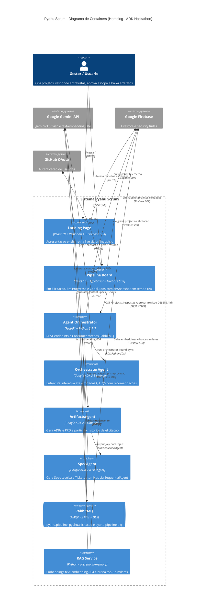

# Pyahu Scrum 🚀

Bem-vindo ao **Pyahu Scrum**, um framework autônomo de orquestração desenvolvido para a categoria **Taskmaster** do [Agent Development Kit Hackathon with Google Cloud](https://googlecloudmultiagents.devpost.com/).

Este projeto democratiza a engenharia de decisão: captura ideias brutas de negócio e, através de **múltiplos agentes ADK colaborando em segundo plano**, as traduz em especificações técnicas rigorosas (ADRs, Spec, PRD) e tickets de desenvolvimento executáveis — tudo via elicitação interativa no estilo Grill-Me.

---

## 🌐 Ambientes

| Ambiente | URL |
|---|---|
| **Homologação** (develop) | https://homolog.pyahuscrum.adbfn6.easypanel.host |
| **API** | https://api-homolog.pyahuscrum.adbfn6.easypanel.host |
| **GCP Project** | `pyahu-scrum` |
| **Firestore** | [console.firebase.google.com/project/pyahu-scrum/firestore](https://console.firebase.google.com/project/pyahu-scrum/firestore) |

---

## 🤖 Agentes ADK

O pipeline é orquestrado por **3 agentes Google ADK 2.8** em colaboração:

| Agente | Função | Tipo ADK |
|---|---|---|
| **OrchestratorAgent** | Elicitação grill-style (rounds Q1..Qn com ➡️ recomendações, estilo /grilling Matt Pocock) | `LlmAgent` |
| **ArtifactsAgent** | Gera ADRs (Architecture Decision Records) + PRD (Product Requirements Doc) | `LlmAgent` |
| **SpecAgent** | Gera Spec técnica + Tickets de desenvolvimento atômicos | `LlmAgent` |

### Fluxo de colaboração

```
OrchestratorAgent  (até 4 rodadas de elicitação, HITL)
      ↓ usuário aprova escopo
SequentialAgent: ArtifactsAgent → SpecAgent
      ↓
ZIP: spec.md + prd.md + ADRs + tickets
```

> **Fallback resiliente:** quando o ADK está indisponível (quota / billing pendente), o sistema cai automaticamente para chamadas diretas ao Gemini — **o pipeline nunca para**.

---

## 🏗️ Estrutura do Repositório

```
PyahuScrum/
├── frontend/                  # React/TypeScript — Pipeline Board (3 páginas)
├── backend/
│   ├── app/
│   │   ├── agents/            # Agentes ADK
│   │   │   ├── orchestrator_agent.py  # Grill-style elicitação
│   │   │   ├── artifacts_agent.py     # ADRs + PRD
│   │   │   ├── spec_agent.py          # Spec + Tickets
│   │   │   └── pipeline.py            # SequentialAgent + Runner
│   │   ├── elicitacao.py      # Orquestração do pipeline + fallback
│   │   ├── artefatos.py       # ZIP de artefatos
│   │   ├── rag.py             # Embeddings + busca por cosseno
│   │   ├── consumer.py        # Worker RabbitMQ (2 filas)
│   │   └── main.py            # FastAPI endpoints
├── infra/                     # Docker + docker-compose
├── specs/                     # Specs e PRDs por fatia
├── docs/adr/                  # Architecture Decision Records
├── firestore.rules            # Security Rules do Firestore
└── firebase.json              # Config para deploy das rules via CLI
```

---

## ⚙️ Arquitetura

### Fluxo completo

```
Usuário acessa /            →  Landing Page (React + Remotion + telemetria live)
Usuário acessa /login       →  Autenticação GitHub OAuth
Usuário cria projeto        →  ProjectsPage → formulário de ideia

POST /projects
  → Firestore: { status: TRIAGEM_INICIAL }
  → RabbitMQ: pyahu.pipeline
  → Retorno imediato 201

Consumer thread (pyahu.pipeline)
  ├─ Tenta: ADK OrchestratorAgent  (gemini-3.6-flash via Gemini API)
  └─ Fallback automático: google-genai direto  (se quota/billing indisponível)
  → Firestore: { status: ELICITANDO, perguntas_abertas: [Q1..Q5 + recomendações] }
  → onSnapshot → Pipeline Board → "Em Elicitação" (card com rodadas)

Usuário responde perguntas  →  POST /projects/{id}/respostas
  → RabbitMQ: pyahu.elicitacao  (tipo: resposta)
  → Consumer → OrchestratorAgent (próxima rodada)
  → Repete até: pronto: true | rodada 4 | usuário força (≥ R2)

OrchestratorAgent sinaliza conclusão
  → Gemini gera Resumo de Escopo (markdown: Ideia · Requisitos · Escopo · Fora do escopo)
  → Firestore: { status: AGUARDANDO_APROVACAO_ESCOPO, resumo_escopo: "..." }
  → onSnapshot → Pipeline Board → "Em Progresso" (card com resumo + botões)

HITL — Usuário analisa o resumo
  ├─ ✅ Aprova   →  POST /projects/{id}/aprovar
  │               →  RabbitMQ: pyahu.elicitacao  (tipo: aprovar)
  │               →  Consumer → ADK SequentialAgent:
  │                    ArtifactsAgent → gera ADRs + PRD
  │                         ↓ output_key
  │                    SpecAgent     → gera Spec técnica + Tickets (máx 15)
  │               →  Firestore: { status: CONCLUIDO, artefatos: {...} }
  │               →  RAG: embedding salvo no Firestore para contexto futuro
  │               →  onSnapshot → Pipeline Board → "Concluídos" + botão ⬇ ZIP
  │
  └─ 📝 Revisão  →  POST /projects/{id}/revisao  { feedback: "..." }
                  →  RabbitMQ: pyahu.elicitacao  (tipo: revisao)
                  →  Consumer → Gemini analisa feedback:
                       ├─ precisa_mais_info: true  → nova rodada (ELICITANDO)
                       └─ precisa_mais_info: false → resumo atualizado

Usuário exclui projeto      →  DELETE /projects/{id}  (botão 🗑 em qualquer página)
  → Firestore: remove doc principal + subcoleção elicitacao/ em lotes (cascade)
  → Consumer: guard _project_exists() — mensagens órfãs descartadas com ack
  → onSnapshot → card removido em tempo real em todas as páginas abertas

Falhas
  → Retry automático: até 3 tentativas por mensagem
  → pyahu.dlx → pyahu.pipeline.dlq  (Dead Letter Queue)
  → Firestore: { status: FALHA_PROCESSAMENTO, failure_reason: "..." }
```

### Diagrama C4



### Tabela de estados do pipeline

| Status | Quem define | O que acontece a seguir |
|---|---|---|
| `TRIAGEM_INICIAL` | `POST /projects` | Consumer → OrchestratorAgent (Rodada 1) |
| `ELICITANDO` | OrchestratorAgent | onSnapshot → card "Em Elicitação" com perguntas |
| `AGUARDANDO_APROVACAO_ESCOPO` | Entrevista concluída | onSnapshot → card "Em Progresso" com resumo markdown |
| `GERANDO_ADR` | Aprovação recebida | SequentialAgent: ArtifactsAgent → SpecAgent |
| `CONCLUIDO` | SpecAgent | onSnapshot → card "Concluídos" + botão ⬇ ZIP |
| `FALHA_PROCESSAMENTO` | 3 tentativas esgotadas | Mensagem → DLQ · card mostra erro |

### RAG — Recuperação de contexto histórico

O backend gera embeddings (`text-embedding-004`) de cada projeto concluído e realiza busca por similaridade de cosseno em Python — preparado para Firestore Vector Search em produção:

$$\text{sim}(q,d)=\frac{q\cdot d}{\|q\|\|d\|}$$

Os 3 projetos mais similares são injetados no prompt dos agentes — evitando repetição e enriquecendo cada spec com decisões de projetos anteriores.

## 🛠️ Stack

| Camada | Tecnologia |
|---|---|
| Frontend | React 18 + TypeScript + Firebase SDK |
| Backend | FastAPI + Python 3.11 |
| **Agentes** | **Google ADK 2.8** (OrchestratorAgent + ArtifactsAgent + SpecAgent) |
| IA | Google Gemini 3.6 Flash + text-embedding-004 |
| Fila | RabbitMQ (homolog) → Google Cloud Pub/Sub (prod) |
| Banco | Google Cloud Firestore (real, projeto `pyahu-scrum`) |
| Infra | Docker + Traefik + Easypanel |

---

## 🚀 Como executar localmente

### Pré-requisitos

- Docker + Docker Compose
- Node.js 22+
- Python 3.11+
- Projeto GCP com Firestore habilitado
- **Billing habilitado** no projeto GCP (necessário para ADK via Vertex AI)

### 1. Clone o repositório

```bash
git clone https://github.com/edcastanha/PyahuScrum.git
cd PyahuScrum
```

### 2. Credenciais GCP

1. Acesse [console.cloud.google.com/iam-admin/serviceaccounts?project=pyahu-scrum](https://console.cloud.google.com/iam-admin/serviceaccounts?project=pyahu-scrum)
2. Crie uma conta de serviço com papéis: `Cloud Datastore User` + `Vertex AI User`
3. Baixe o JSON e salve em `backend/pyahu-scrum-sa.json`

### 3. Backend

```bash
cd backend

# Criar .env (nunca commitar!)
cat > .env << EOF
GEMINI_API_KEY=<sua_chave_gemini_api>
GOOGLE_CLOUD_PROJECT=pyahu-scrum
GOOGLE_APPLICATION_CREDENTIALS=/app/pyahu-scrum-sa.json
EOF

pip install -r requirements.txt
uvicorn app.main:app --reload --port 8001
```

> **ADK com Vertex AI (recomendado):** requer billing habilitado no GCP.
> **ADK com Gemini API key (free tier):** funciona até 20 req/dia sem billing — fallback automático garante continuidade.

### 4. Frontend

```bash
cd frontend
npm install
# Edite REACT_APP_AGENT_ORCHESTRATOR_URL=http://localhost:8001
cp .env.example .env.local
npm start
```

### 5. Stack completa via Docker (homolog)

```bash
# Pré-requisito: backend/pyahu-scrum-sa.json presente
git checkout develop && git pull origin develop
docker compose -f infra/docker-compose.homolog.yml up -d --build
```

---

## 🔥 Firestore Security Rules

O frontend acessa o Firestore diretamente via Firebase SDK (onSnapshot em tempo real). As rules permitem leitura pública e bloqueiam escrita pelo browser — o backend escreve via Service Account (ignora rules):

```javascript
rules_version = '2';
service cloud.firestore {
  match /databases/{database}/documents {
    match /projects/{projectId} {
      allow read: if true;
      allow write: if false;
      match /elicitacao/{rodada} {
        allow read: if true;
        allow write: if false;
      }
    }
  }
}
```

Para publicar as rules via CLI:
```bash
GOOGLE_APPLICATION_CREDENTIALS=backend/pyahu-scrum-sa.json \
  firebase deploy --only firestore:rules --project pyahu-scrum
```

---

## 🗂️ Pipeline de Elicitação

O pipeline passa por 4 fases visíveis na sidebar:

| Página | Rota | Status do projeto |
|---|---|---|
| **Em Elicitação** | `/pipeline/elicitacao` | `TRIAGEM_INICIAL`, `ELICITANDO` |
| **Em Progresso** | `/pipeline/progresso` | `AGUARDANDO_APROVACAO_ESCOPO`, `GERANDO_ADR` |
| **Concluídos** | `/pipeline/concluido` | `CONCLUIDO` |

Cada card exibe o histórico de rodadas (1–4). Rodadas respondidas ficam desabilitadas. Na página Concluídos, o botão **⬇ Baixar ZIP** entrega `spec.md + prd.md + ADRs + tickets`.

---

## 🛡️ Governança e Human-in-the-Loop

O Pyahu Scrum implementa política estrita de resiliência:

- **Retry automático** — até 3 tentativas por mensagem antes de ir para a DLQ (`pyahu.pipeline.dlq`)
- **Guard de delete** — consumer verifica se o projeto ainda existe antes de processar mensagens órfãs
- **HITL de aprovação** — após a elicitação, o Gemini gera um resumo de escopo em markdown. O usuário revisa e pode:
  - **✅ Aprovar** → dispara `ArtifactsAgent → SpecAgent` para gerar os artefatos
  - **📝 Revisar** → envia feedback; Gemini decide se precisa de mais rodadas ou atualiza o resumo
- **Fallback ADK → Gemini direto** — se o ADK falhar (quota/billing), o pipeline continua com chamadas diretas ao Gemini

---

## 📁 Credenciais e Segredos

| Arquivo | Descrição | Gitignored |
|---|---|---|
| `backend/.env` | `GEMINI_API_KEY`, `GOOGLE_CLOUD_PROJECT`, `GOOGLE_APPLICATION_CREDENTIALS` | ✅ |
| `backend/pyahu-scrum-sa.json` | Service Account GCP (Firestore + Vertex AI + ADK) | ✅ |

**Nunca commitar credenciais.** O `.gitignore` bloqueia arquivos sensíveis na pasta `backend/`.

---

## ⚡ Ativar ADK via Vertex AI (billing)

O ADK usa Vertex AI para chamadas de produção (sem limite de quota diária):

1. Acesse: https://console.developers.google.com/billing/enable?project=pyahu-scrum
2. Vincule um cartão de crédito ou use créditos GCP disponíveis
3. Reinicie o container da API:
   ```bash
   docker restart pyahuscrum-api-homolog
   ```

Após o billing, os 3 agentes ADK passam a usar `GOOGLE_GENAI_USE_VERTEXAI=true` automaticamente via `GOOGLE_APPLICATION_CREDENTIALS`.
